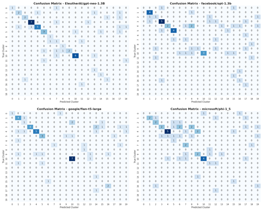
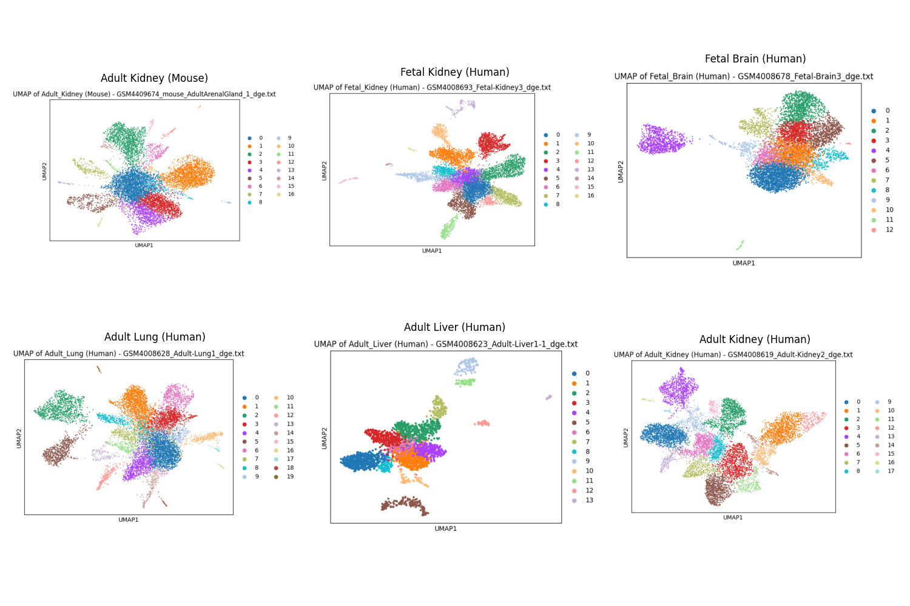

# **Benchmarking Open-Source LLMs for Cell Type Annotation in scRNA-seq Data**

## **Project Overview**
This project evaluates the performance of various open-source **Large Language Models (LLMs)** for **cell type annotation** in **single-cell RNA sequencing (scRNA-seq) data**. Traditionally, cell type annotation is a **manual and error-prone process**, but recent advancements in **LLMs** have enabled automation. This study benchmarks models like **EleutherAI/gpt-neo-1.3B, Facebook/opt-1.3b, Google/flan-t5-large, and Microsoft/phi-1_5** to determine their effectiveness in identifying cell types.

## **Key Highlights**
- **Motivation**: Automating cell type annotation can significantly speed up **bioinformatics research** and make it more **accessible**.  
- **Models Evaluated**:
  - 🧠 **EleutherAI/gpt-neo-1.3B**  
  - 🤖 **Facebook/opt-1.3b**  
  - 🔍 **Google/flan-t5-large**  
  - 📊 **Microsoft/phi-1_5**  
- **Benchmark Metrics**:
  - **Accuracy, Precision, Recall, and F1 Score** were used to evaluate the models.
- **Best Model**: **EleutherAI/gpt-neo-1.3B** showed the **highest accuracy (57%)**, but all models struggled with verbosity and required **fine-tuning**.

---

## **Methodology**
### 1️⃣ **Data Preprocessing**
- Datasets were obtained from public sources like **NCBI GEO Database**.
- Used **Scanpy** to filter, normalize, and preprocess **scRNA-seq** data.
- Applied **PCA & UMAP** for **dimensionality reduction**.

### 2️⃣ **Model Evaluation**
- Each model was **queried** with gene expression data using a structured **JSON prompt**.
- Responses were **parsed** and **evaluated** against manually annotated datasets.

### 3️⃣ **Performance Metrics**
- **Accuracy**: Percentage of correct cell type predictions.
- **Precision & Recall**: Assessed false positive and false negative rates.
- **F1 Score**: Balanced metric for model evaluation.

---

## **Results & Findings**
| Model                  | Accuracy | Precision | Recall | F1 Score |
|------------------------|----------|----------|--------|----------|
| **EleutherAI/gpt-neo-1.3B**  | 57%  | 0.57  | 0.51  | 0.57  |
| **Google/flan-t5-large**  | 49%  | 0.49  | 0.45  | 0.49  |
| **Facebook/opt-1.3b**  | 41%  | 0.41  | 0.38  | 0.41  |
| **Microsoft/phi-1_5**  | 37%  | 0.37  | 0.33  | 0.37  |

🔹 **Key Takeaways**:
- **EleutherAI/gpt-neo-1.3B** had the **best overall performance**.
- **All models struggled with strict prompt compliance**.
- **Fine-tuning models on bioinformatics data could improve accuracy**.

---

## **Result Graphs**







The full write-up is in [Report.pdf](Report.pdf).

## **Installation & Usage**
### 📌 **Dependencies**
Ensure you have the following Python packages installed:
```bash
pip install transformers scikit-learn pandas scanpy matplotlib
```

### ▶️ **Run the Benchmarking Script**
```bash
python benchmarking_llms.py
```
OR use the **Jupyter Notebook**:
```bash
jupyter notebook benchmarking_llms.ipynb
```

---

## **Future Work**
🔹 Fine-tuning models with **domain-specific datasets** to improve accuracy.  
🔹 Exploring **larger models (e.g., Llama-2 70B, DBRX)** for better cell type predictions.  
🔹 Expanding datasets to include **disease-specific tissues (e.g., cancer data)**.  

---

## **Contributors**
👤 **Sanskar Pant** – [LinkedIn](https://www.linkedin.com/in/sanskar-pant-44b3801ab)  
📧 **Email**: sanskarpant@example.com  

---

## **License**
📜 MIT License - You are free to use, modify, and distribute this project.  

🚀 If you find this project useful, **star 🌟 the repository on GitHub!** 😊  
